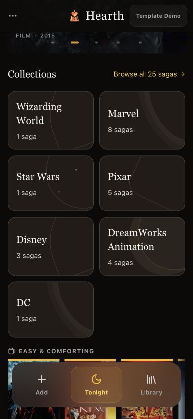
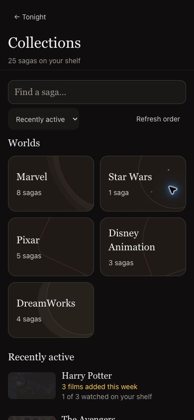
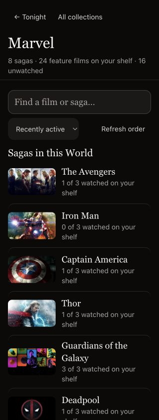
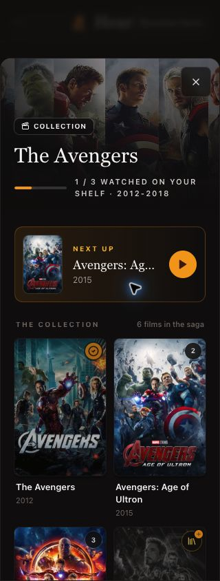

# Collections validation

Revision reviewed on **2026-10-26**. The correction puts every represented World directly on Tonight and keeps World → saga → film navigation distinct from editorial Collection eligibility.

## Automated checks

Integrated working branch validation:

- `npm test`: **266 unit tests in 48 suites and 26 API tests**, all pass.
- `npm run lint:ci`, `npm run format:check` and `npm run build` pass.
- The expanded synthetic metadata fixture contains 50 verified, editorially eligible saga IDs; the normalization/classification integration test keeps all 50 reachable.
- The isolated PR checkout is validated separately after applying the correction; its smaller suite excludes pre-existing UI/performance work on the integrated branch.

Targeted shared-preference validation completed:

- **21 service/hook tests pass**, including explicit false versus absent override, canonical identity validation, realtime snapshots, delayed Firebase initialization, stale household callbacks/errors, write failures, no-household failure and template isolation across view navigation.
- Targeted lint for the new preference service/hook files passes with zero warnings.
- **25 Firestore rule checks pass** against the actual Firestore emulator using isolated project `demo-hearth-collections` on a dedicated local port. These test member reads/lists, two-member overwrite/reset, outsiders and anonymous clients, cross-household paths, invalid/oversized keys, missing fields, wrong types, extra fields, forged historical timestamps and update validation bypass.
- Official Firebase rules compilation dry run passes. It performed no rules release or production deployment.
- `graphify update .` completes with AST extraction and no LLM calls. Generated graph output is ignored by Git.

Run the rule attack suite only with an emulator, for example:

```sh
npx -y firebase-tools@latest emulators:exec --only firestore \
  --project demo-hearth-collections \
  'node scripts/testCollectionPreferenceRules.cjs'
```

The script refuses to run without `FIRESTORE_EMULATOR_HOST`. An isolated temporary Firebase config can select a dedicated Firestore port if the default is already occupied. No new dependency is required.

## Scope and release boundary

The household override backend below is **dormant**: no UI uses it and no listener is opened, so Collections renders immediately from the editorial catalog. Collection display overrides were built to live at `artifacts/{appId}/spaces/{spaceId}/collection_preferences/{provider:collectionId}` and are shared through realtime household snapshots. A boolean override wins over editorial defaults; deleting the document restores absence. Template preferences stay in memory and never write to Firestore.

**The new preference rules are source-only until the reviewed future release.** Deploy the matching `firestore.rules` with that release only if the override UI is ever restored. Nothing in this work releases or deploys the app, and no production household data was modified during validation. See [the scoped security audit](collection-preferences-security-audit.json).

Movie watch-transition transaction behavior is tested separately against controlled SDK mocks; live multi-device watch-status contention remains unverified. Shared preference authorization and two-client writes/reset have actual emulator coverage.

The final UI review covers 320×844, 390×844 and 448×844, with the six-tile Worlds grid on Tonight, direct World entry even for a single saga, the plain all-saga index, provider fallback, and scroll/focus restoration. Regenerate the captures below from the final integrated UI rather than relying on the previous two-saga-preview screenshots.

## Screenshots

Captures use the integrated demo UI and a synthetic household.

| Surface | 320px | 390px | 448px |
| --- | --- | --- | --- |
| Tonight | [capture](screenshots/tonight-320.jpg) | [capture](screenshots/tonight-390.jpg) | [capture](screenshots/tonight-448.jpg) |
| Overview | [capture](screenshots/overview-320.jpg) | [capture](screenshots/overview-390.jpg) | [capture](screenshots/overview-448.jpg) |
| World | [capture](screenshots/world-320.jpg) | [capture](screenshots/world-390.jpg) | [capture](screenshots/world-448.jpg) |
| Saga | [capture](screenshots/saga-320.jpg) | [capture](screenshots/saga-390.jpg) | [capture](screenshots/saga-448.jpg) |







## Final browser checks

Every represented World is visible directly on Tonight, including Wizarding World and DC. At 320/390/448px the document width matches the viewport and new collection controls meet 44px. A singleton Wizarding World opens its own page; back restores the originating Tonight tile. Film Escape restores saga Next up focus, then saga Escape restores its World row. This was checked in a real browser, including the background-inert focus behavior that jsdom does not emulate.

The Manage sagas control was later removed. Twelve refreshed captures show the 25-saga synthetic library. No release, production rules deployment or production household mutation was performed.
