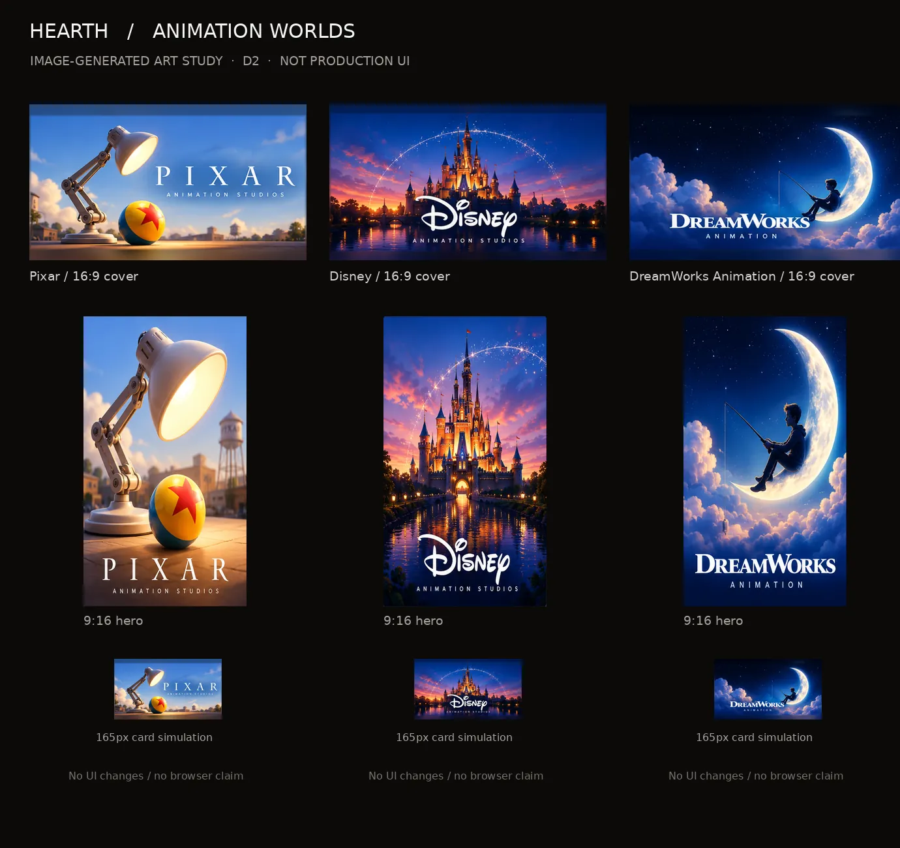

# Direction D2 animation artwork — image-generated raster pack

**Issue:** [#12](https://github.com/BenWassa/hearth_v2/issues/12) · **Parent contract:** [#10](https://github.com/BenWassa/hearth_v2/issues/10)  
**Branch:** `art/worlds-animation` · **Status:** Review required; not merged/brand-cleared · **Created:** 2026-10-26

## Preview

The contact sheet is a local composition preview assembled from **real generated PNG source art**, not an in-app screenshot. #14 owns browser screenshots and UI integrations; no UI files were edited.

## Deliverables

Each animation World contains:

- **`cover.webp`**, exactly **1600 × 900 px**, RGB, optimized for Tonight's 16:9 landscape cards
- **`hero.webp`**, exactly **1080 × 1920 px**, RGB, separately composed from each generated portrait art panel, not derived from the cover
- **`wordmark.png`**, transparent image-generated PNG signature. The rejected SVG wrappers are removed; accessible semantic text must be provided by the integration UI.
- **`cover-source.png` / `hero-source.png`**, the lossless cropped source panels from image generation, provided for inspection and later recomposition; they are smaller than export dimensions and are **not** claimed as full-resolution generated masters

| World | 16:9 WebP | 9:16 WebP | Source PNG (cover) | Source PNG (portrait) | Transparent raster signature |
| --- | ---: | ---: | ---: | ---: | ---: |
| `pixar` | 45.7 KB | 75.7 KB | 147.7 KB | 284.2 KB | 8.4 KB |
| `disney-animation` | 76.1 KB | 156.4 KB | 188.7 KB | 392.8 KB | 11.7 KB |
| `dreamworks` | 53.8 KB | 95.1 KB | 170.7 KB | 308.4 KB | 16.0 KB |

The preview sheet is `public/assets/worlds/pixar/animation-contact-sheet.webp` (~114.9 KB). All six WebPs were decoded with Pillow and checked for exact pixel size and RGB encoding. All covers are **under 350 KB** and all heroes **under 600 KB**.

## Art direction and responsive crop

| World | Cover / portrait composition | Focal priority | Small-card guidance |
| --- | --- | --- | --- |
| **Pixar** | Warm studio-lit lamp/ball tableau; independently generated large-lamp portrait with bright centre light | lamp head and ball; cover midpoint ~42% x, portrait ~52% x | Full 16:9 image at 165px wide; avoid cropping further into the lamp and title |
| **Disney** | Amber-lit fantasy castle, water reflections and circular starlight; portrait centres spires rather than cropping cover | castle spires and waterline; centre x | Preserve center and upper tower; keep interface labels outside image |
| **DreamWorks** | Night-blue cloudscape and luminous crescent, with a small fishing silhouette; portrait reinterprets crescent/sky | moon, seated figure and cloud base; slightly right of centre | Keep full 16:9 bounds; long name needs separate semantic label |

Landscape exports preserve full source width with modest atmospheric extension rather than cropping off wordmarks. The independent source portrait panels are not native 9:16: the hero exports are adapted to 1080×1920, so review at 390px is especially important. Do not use a blind `object-fit: cover` on the entire 9:16 image if it will crop generated title artwork. Suggested `object-position`: Pixar `50% 45%`, Disney `50% 40%`, DreamWorks `50% 45%`. World-page heroes should only occupy the top portion of the screen so saga items remain visible or peek below, per #10.

**Small-size checks:** contact-sheet 165×93px cards correspond to a 390px phone's two-column layout. At 320 and 448px, corresponding two-column content widths will be roughly 130–195px depending on gutter; separate semantic name text must remain readable even if generated microtype is not. Keyboard/focus and live contrast checks belong to lane #14; no app/browser validation is claimed here.

## Provenance, trademarks and image limitations

- **Source:** Original images generated for this task using OpenAI image generation on **2026-10-26**. Source scene: `a_clean_high_quality_poster_like_collage_of_anim.png` (1536×1024). The generated sheet included distinct covers, portrait images and wordmark panels. It was then subdivided into PNG source panels and locally exported as WebP with Pillow. There are **no third-party image download URLs or scraped studio image files**.
- **Generator trace:** image generation ID `5b9a4a53-4654-4df8-b09c-c0bddc846794`. Other visual iterations were considered but not committed. Preserve the raw generated study outside the runtime asset tree if remastering is needed.
- **Source quality:** source panels measure roughly 490–506px across covers and 417–432px across portraits. Raster resampling produces the exact contractual WebP dimensions but **does not add genuine high-resolution detail**. Review on retina/large displays before merge. Artifacts must not be described as native 1600×900 or native 1080×1920 *generation*.
- **Marks / rights:** The image model rendered signatures and motifs *evocative of existing studio title cards*. It may closely resemble established studio logos, trade dress, or protected visual elements (notably Pixar lamp/ball, Disney castle/script, and DreamWorks moon/angler). No trademark licence, affiliation, endorsement or permission is asserted. Since Hearth may become publicly distributed, **owner/licensing review is a required merge gate**; replace or remove any risky motif/signature before public release if rights are not independently established. A plain-text accessible World title remains the recommended legal fallback.
- **Text and overlay caveat:** Image-generation source panels include studio name artwork baked into images. This is a conscious divergence from #10's preference for text-free raster, because the supplied image generator repeatedly produced full brand-led title compositions. `wordmark.png` is an optional presentation asset; **do not overlay them onto the same baked-in titles**. UI must always expose the World name as live accessible text, including on offline/error fallback. No counts, buttons, watch state or private data are embedded.
- **No original corporate files:** The generated renderings should be treated as unlicensed concept renderings, *not* accurate official logo files or released marketing imagery.

## QA and review gates

- [x] Three generated image-based 16:9 covers, three independently generated portrait treatments, and three raster wordmark signatures
- [x] `cover.webp` and `hero.webp` decode as RGB at exactly 1600×900 and 1080×1920
- [x] All WebPs are within parent issue target transfer budgets
- [x] Cropped source PNGs retained for transparency and rework; The PNG is the sole wordmark asset; SVG wrappers removed at owner's direction
- [x] 165px two-column card simulation and portrait previews in contact sheet
- [x] No React, CSS, config, Firestore, shared design or other-lane files changed
- [ ] Visual owner approval for noncommercial/brand fidelity and mobile legibility
- [ ] Explicit trademark/rights decision for publicly distributed app
- [ ] Browser screenshots and 320/390/448px responsive validation after lane #14 integration

**Review recommendation:** Evaluate studio recognition, small-card title clarity and the portrait's source-resolution compromises. If either are inadequate, request **six independently generated full-resolution images** rather than accepting an upscale as equivalent. Do not merge automatically.

## Owner format decision — 2026-10-26

The owner rejected SVG wordmarks and requested **image-generated PNG instead**. The three SVG wrappers have therefore been removed from the branch. The standalone transparent `wordmark.png` files remain as the sole signatures for integration. If #14 needs a name at 130–195px card width, it must use live accessible HTML text rather than a vector fallback. The generated studio names embedded in the WebP scene are presentation art, not an accessibility substitute.
