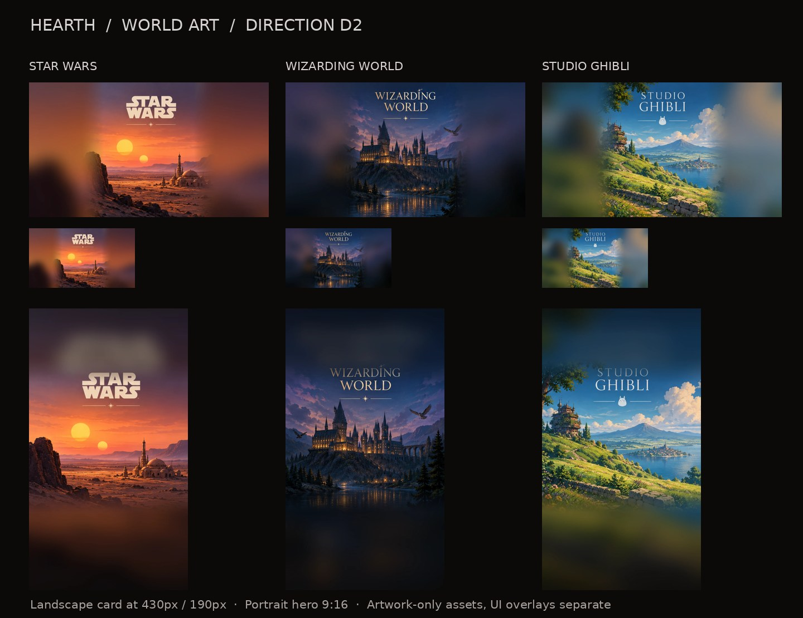
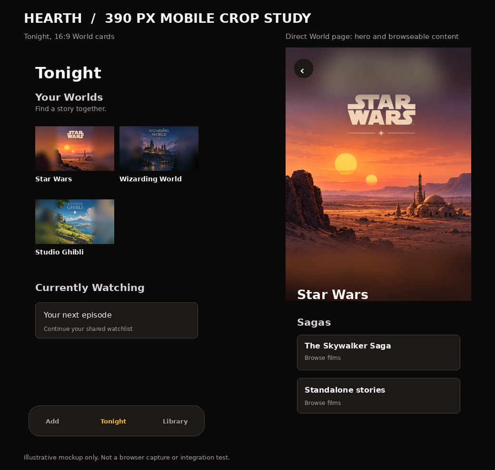

# Lane C: galactic and magical World artwork

- **Issue:** [#13](https://github.com/BenWassa/hearth_v2/issues/13)
- **Direction contract:** [#10](https://github.com/BenWassa/hearth_v2/issues/10), D2
- **Branch:** `art/worlds-galaxy-magic`
- **Date:** 2026-10-26
- **Status:** Ready for owner visual review; no merge or deployment performed.

## Preview

The second image is a **static crop/layout study**, not a browser screenshot. Actual rendering, content hydration, accessibility, focus and navigation belong to integration issue #14.

## Asset inventory

| World | Asset | Native size | On-disk size |
|---|---|---:|---:|
| Star Wars | `star-wars/cover.webp` | 1600×900 | 49.5 KiB |
| Star Wars | `star-wars/hero.webp` | 1080×1920 | 72.7 KiB |
| Star Wars | `star-wars/wordmark.svg` | 960×180 viewBox | 0.3 KiB |
| Wizarding World | `wizarding-world/cover.webp` | 1600×900 | 64.0 KiB |
| Wizarding World | `wizarding-world/hero.webp` | 1080×1920 | 94.2 KiB |
| Wizarding World | `wizarding-world/wordmark.svg` | 960×180 viewBox | 0.3 KiB |
| Studio Ghibli | `studio-ghibli/cover.webp` | 1600×900 | 96.7 KiB |
| Studio Ghibli | `studio-ghibli/hero.webp` | 1080×1920 | 149.3 KiB |
| Studio Ghibli | `studio-ghibli/wordmark.svg` | 960×180 viewBox | 0.3 KiB |

Assets are in `public/assets/worlds/<id>/`. Covers and heroes are RGB WebP with no alpha. Dimensions were checked after encoding by opening every file with Pillow. All cover files are well below the 350 KiB guidance and all heroes below 600 KiB.

## Creative treatment and composition

- **Star Wars:** sunset desert with twin suns, a distant outpost and restrained cinematic warm/cool grading. Original scene extended horizontally for the 16:9 frame and vertically for 9:16, with safe dark falloff.
- **Wizarding World:** illuminated castle / mountain lake under a dusky sky; elegant bookish title signature and dark negative space.
- **Studio Ghibli:** rural hill, garden, sky, lake and a softly lit house; brighter natural hues within Hearth's near-black stone chrome.

The images originated from a single ImageGen multi-panel source image. Each panel was isolated, and the landscape and portrait variants were separately composited: source geometry retained without aspect distortion; atmospheric extensions were constructed by fitting, masking, feathering and softly blurring source-derived textures. Therefore the portrait heroes are **independent layouts using the same generated scene**, not separately generated source paintings. The preview is included to make those compositing choices inspectable.

The image-generation source includes typography already visible in each scenic panel. Dedicated transparent `wordmark.svg` assets are also provided so the integration may use scalable, accessible names. Avoid placing both the separate wordmark and the raster title over the same area. If the integrator uses plain HTML titles, prefer those for smaller accessibility scenarios.

## Mobile focal points and crops

- **Landscape:** center the composition, not the far edges; the title and key object are within the central half of the 1600px canvas. A 16:9 card uses the full frame. At approx. 160–190px physical CSS width, prefer accessible text adjacent to the image or a standalone wordmark instead of trusting small raster typography.
- **Portrait:** core scenic detail is concentrated around **y ≈ 650–1350** at 1080×1920; upper and lower areas are intentionally low detail for a back affordance and metadata fade. Use a height-limited hero, not a full-screen mandatory splash, so sagas are visible immediately below.
- **Hearth shell:** `#0c0a09`; Hearth controls retain `#d97706` amber. The brighter localized orange, blue and green are within the artwork only.
- **Text layering:** do not add baked-in episode counts, watch state, buttons, progress or instructional labels. Existing text signatures are artwork-level titles, not UI controls.

## Provenance and rights

- **Source:** OpenAI ImageGen output generated on 2026-10-26, in response to issue #13's galaxy/magic art direction. One multi-panel original generation was cropped and recomposed locally using Pillow, then saved with the WebP encoder. No external stock photographs, commercial key art files, or copied logos were downloaded to construct these files.
- **Title signatures:** small hand-authored, typography-based SVGs using generic CSS font stacks, not externally supplied font files; accessible `<title>` text.
- **Trademark and resemblance:** Names and some generated forms evoke existing entertainment properties. Generation does not itself establish third-party permissions, ownership or clearances. This is an art review pack for a personal watchlist; verify suitability before wider distribution. No third-party approval or endorsement is claimed.
- **Source master:** Source generation in the associated ChatGPT conversation. The contact sheet and final optimized outputs are committed; no proprietary prompt/model weights or external source photography included.

## QA recorded

- [x] Six RGB WebP images encode and decode in Pillow.
- [x] Three landscape assets at **1600×900**.
- [x] Three portrait assets at **1080×1920**.
- [x] All images below issue #13 WebP size guidance.
- [x] Three transparent scalable name-signature SVGs.
- [x] Contact sheet and 390px mock preview under Hearth shell-black.
- [x] Artwork and documentation owned by this lane only.
- [ ] Actual browser/Pixel crop, font fallback, screen-reader focus and slow-network behavior: **integration issue #14**; cannot be validated from standalone artwork.
- [ ] Human aesthetic review, especially small 160px raster title legibility.

## Integration handoff

1. Keep IDs and static paths exactly as in the existing World manifest; do not change mapping in this lane.
2. Render `<picture>`/`` with the landscape cover inside Tonight's 16:9 cards and the portrait hero on the direct World page; apply accessible World name labels.
3. Provide title contrast via a dark scrim on the image where needed. Avoid duplicating embedded art-level typography with a second overlay.
4. Respect one-tap navigation and visible saga content as required by #10; no Explore gate or autoplay.

**Do not merge before review.** The preview is illustrative, not evidence of browser QA.
