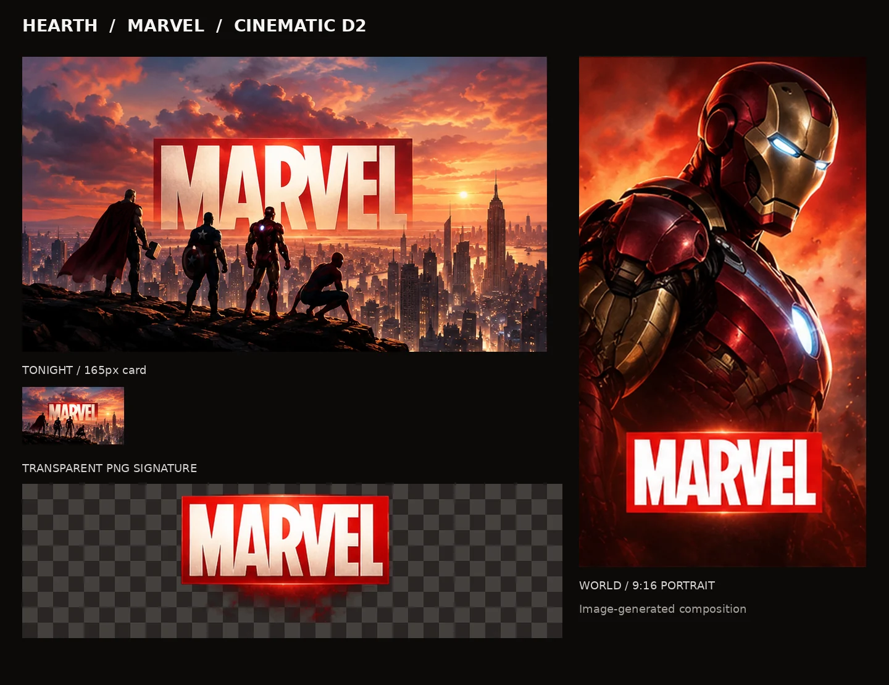
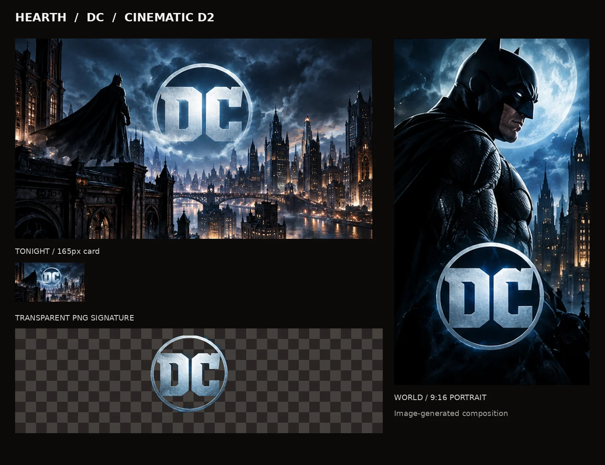

# Superhero World artwork — cinematic D2 revision

**Issue:** [#11](https://github.com/BenWassa/hearth_v2/issues/11) · **Contract:** [#10](https://github.com/BenWassa/hearth_v2/issues/10)

## Visual previews

## Art direction

- Marvel: golden-hour heroic ensemble on an elevated ledge above a sprawling city, with red title treatment; armored character portrait.
- DC: nocturnal gothic skyline, dramatic caped hero silhouette and luminous blue circular title emblem; moonlit portrait.
- Art direction matches the cinematic, image-generated composition and dimensional lighting of animation lane PR #15, not flat vector motifs.
- Covers are full-bleed 16:9, portrait scenes independently composed 9:16, and separate wordmark PNGs are transparent.

## Production asset details

| World | File | Pixels | Size (KiB) |
|---|---|---:|---:|
| marvel | `cover.webp` | 1600×900 | 159.4 |
| marvel | `hero.webp` | 1080×1920 | 140.0 |
| marvel | `wordmark.png` | 1600×900 | 647.6 |
| marvel | `cover-source.png` | 894×509 | 656.1 |
| marvel | `hero-source.png` | 319×509 | 247.7 |
| marvel | `preview.webp` | 1440×1110 | 143.6 |
| dc | `cover.webp` | 1600×900 | 177.0 |
| dc | `hero.webp` | 1080×1920 | 124.0 |
| dc | `wordmark.png` | 1600×900 | 559.6 |
| dc | `cover-source.png` | 894×510 | 724.2 |
| dc | `hero-source.png` | 319×510 | 240.8 |
| dc | `preview.webp` | 1440×1110 | 141.1 |

## Provenance and limitations

- Generated using OpenAI image generation on 2026-10-26; generated image ID `ec26288b-ceaa-49ff-a1f6-98d20a5aaf3c`.
- Source is one 1536×1024 image-generated multi-panel cinematic concept sheet; source landscape and portrait panels are cropped separately and retained as PNGs.
- Exported WebPs meet required dimensions via Lanczos resampling; source panels are lower resolution, so exports are **not** claimed to contain native full-resolution detail.
- Generated lettering is baked into the WebP scenes. `wordmark.png` is an optional standalone transparent signature; **do not overlay it onto already titled imagery**.
- No externally downloaded film posters, photos or corporate artwork files were used. Generated depictions evoke identifiable third-party characters, marks, and studio identities. No license or endorsement is claimed; review before public distribution.
- Accessible live World names are still required in the UI.

## Responsive and QA notes

- Covers retain the complete 16:9 frame; 165px two-column card reproductions are shown in each preview.
- Portrait heroes use central focal subjects; keep `object-position: 50% 45%` initially and verify against the final World UI.
- Verify at 320px, 390px and 448px in the integration lane; contact sheets are image previews, not browser screenshots.
- No React, shared styles, app configuration, other World assets, or shared design files modified.
- Do not merge without owner review.
